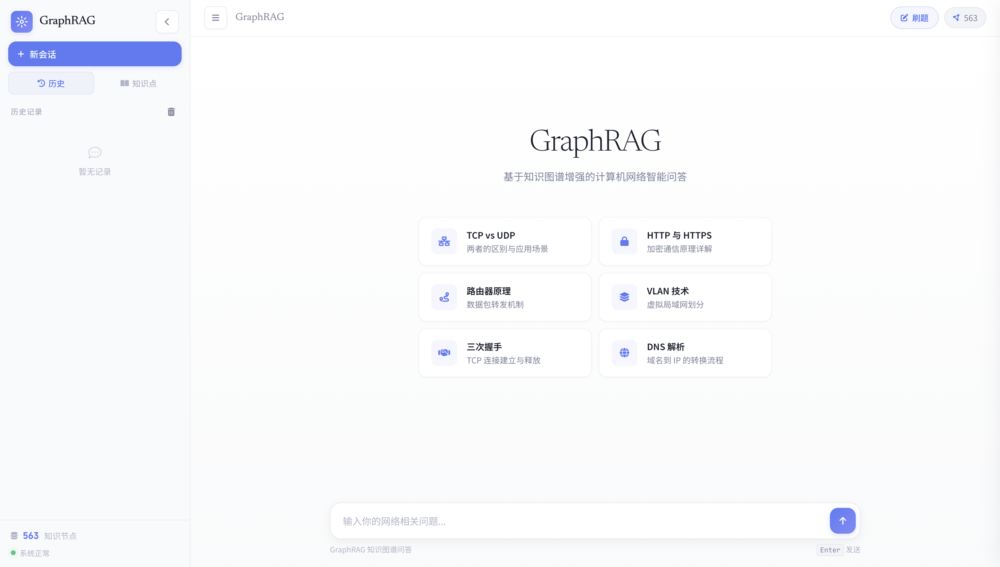

# GraphRAG 计算机网络知识图谱问答系统

基于 Neo4j 图数据库和大模型的计算机网络知识问答系统，采用 FastAPI + LangGraph + LangChain 架构，支持混合检索、流式输出、会话记忆、刷题测验和掌握度追踪。

## 项目简介

面向计算机网络领域的智能学习辅助系统，核心特性：

- **知识图谱存储** — Neo4j 按 5 层 OSI 模型分层存储协议、设备、概念等知识
- **智能问答** — LangGraph ReAct Agent 自主选择工具（知识搜索、图可视化、统计、节点搜索、邻居探索），SSE 流式输出
- **混合检索** — 语义向量检索 + 关键词精确匹配（Cypher CONTAINS），合并排序返回精准结果
- **会话持久化** — SqliteSaver 持久化存储，服务器重启不丢失对话历史
- **刷题测验** — 选择题练习，错题收集，答题结果自动联动知识掌握度追踪
- **掌握度追踪** — 记录学生对知识点的掌握状态，智能推荐未掌握内容
- **速率限制** — 按 IP + 端点分级限流，保护 API 资源
- **工程化** — pydantic-settings 配置校验、API Key 认证、structlog 结构化日志、tenacity 自动重试
- **Web 界面** — D3.js 交互式图可视化、语音输入、会话管理、暗色主题

## 主页展示



## 技术栈

| 类别 | 技术 |
|------|------|
| 后端 | FastAPI + Uvicorn |
| AI 框架 | LangGraph + LangChain |
| 图数据库 | Neo4j |
| LLM | 智谱AI GLM-4-Flash（主模型）|
| 关键词提取 | Qwen-Turbo（with_structured_output）|
| Embeddings | Qwen text-embedding-v3（1024 维）|
| 配置管理 | pydantic-settings |
| 日志 | structlog |
| 重试 | tenacity |
| 前端 | HTML5 / CSS3 / JavaScript / D3.js |

## 快速开始

### 环境要求

- Python 3.9+
- Neo4j 5.x+（需向量索引支持）
- 智谱AI API Key
- 通义千问 API Key（用于 Embeddings 和关键词提取）

### 安装步骤

1. **克隆项目**
   ```bash
   git clone <repository-url>
   cd aigc
   ```

2. **安装依赖**
   ```bash
   pip install -r requirements.txt
   ```

3. **获取 API Key**
   - 智谱AI：[open.bigmodel.cn](https://open.bigmodel.cn) 注册获取
   - 通义千问：[DashScope 控制台](https://dashscope.console.aliyun.com/) 注册获取

4. **配置环境变量**

   创建 `.env` 文件：
   ```bash
   # Neo4j（必填）
   NEO4J_URI=bolt://localhost:7687
   NEO4J_USER=neo4j
   NEO4J_PASSWORD=your-password

   # 智谱AI LLM（必填）
   ZHIPUAI_API_KEY=sk-your-api-key
   ZHIPUAI_MODEL=glm-4-flash

   # Qwen API（语义检索和关键词提取必需，二选一）
   QWEN_API_KEY=sk-your-api-key
   # DASHSCOPE_API_KEY=sk-your-api-key

   # Qwen 模型（可选）
   QWEN_EMBEDDING_MODEL=text-embedding-v3
   QWEN_CHAT_MODEL=qwen-turbo

   # Web（可选）
   WEB_HOST=0.0.0.0
   WEB_PORT=5001
   DEBUG=false

   # API 认证（可选，不设则跳过认证）
   API_KEY=your-secret-key

   # 会话存储（可选，默认 sqlite 持久化）
   MEMORY_BACKEND=sqlite
   SQLITE_DB_PATH=graphrag_checkpoints.db

   # 日志（可选）
   LOG_LEVEL=INFO
   LOG_FORMAT=console

   # 快速启动（可选，跳过初始化延迟到首次查询）
   FAST_START=false
   ```

5. **启动 Neo4j**

   确保 Neo4j 运行中，可通过 http://localhost:7474 访问管理界面

6. **导入知识数据**
   ```bash
   python scripts/build_from_json.py          # 从 data/layers/*.json 导入
   python scripts/generate_embeddings.py      # 生成 Qwen 向量嵌入
   ```

7. **启动应用**
   ```bash
   python run.py --mode web
   # 自定义参数
   python run.py --mode web --host 0.0.0.0 --port 5001 --debug
   ```

8. **访问** http://localhost:5001

## 系统架构

```
用户提问
    │
    ▼
FastAPI  ←──  web/graph_rag_web.py
  ├── RateLimitMiddleware  — 按 IP 滑动窗口限流
  ├── APIKeyMiddleware     — X-API-Key 认证
  └── SSE Streaming        — POST /api/query/stream 流式输出
    │
    ▼
GraphRAGAgent  ←──  src/graphrag_agent.py
  LangGraph ReAct Agent + SqliteSaver 持久会话
  LLM (ZhipuAI) 自主选择工具:
    ├── knowledge_search   → 混合检索 + 图可视化数据
    ├── graph_statistics   → 图统计信息
    ├── node_search        → 关键词 + 语义节点搜索
    └── node_neighbors     → 邻居探索
    │
    ▼
EntityRetriever  ←──  src/services/entity_retriever.py
  混合检索（每次查询只提取一次关键词）:
    1. KeywordExtractor → Qwen with_structured_output 提取关键词
    2. _semantic_search() → 关键词向量化 → Neo4j 向量索引 → top-K
    3. _keyword_match()   → Cypher CONTAINS 精确匹配 → 计分
    4. 合并去重排序 → build_context() 组装上下文
    │
    ▼
Neo4j 图数据库
  节点: Layer, Entity (Protocol/Device/Concept), Question, Answer, MCQuestion
  关系: CONTAINS, ABOUT, RESPONDS_TO, DEPENDS_ON, WORKS_WITH, APPLY_TO
  向量索引: entity_embedding_index (cosine, 1024-dim)
```

## 项目结构

```
aigc/
├── scripts/                    # 数据导入脚本
│   ├── build_from_json.py      # JSON → 分层知识图谱
│   ├── generate_embeddings.py  # 生成 Qwen 向量嵌入
│   └── import_mcq.py           # 导入选择题
├── src/                        # 核心源代码
│   ├── settings.py             # 配置中心（pydantic-settings）
│   ├── exceptions.py           # 自定义异常体系
│   ├── logging_config.py       # 结构化日志（structlog）
│   ├── graphrag_agent.py       # ReAct Agent + 工具 + 流式输出
│   ├── langchain_config.py     # 配置兼容层 → Settings
│   ├── embedding_manager.py    # Qwen Embedding 管理
│   ├── keyword_extractor.py    # Qwen 关键词提取 (with_structured_output)
│   ├── mastery_tracker.py      # 知识掌握追踪（SQLite）
│   ├── image_generator.py      # Graphviz 图谱图片生成
│   └── services/               # 业务服务层
│       ├── entity_retriever.py # 混合检索 + 上下文构建
│       ├── entity_service.py   # 实体列表 + 文本实体提取
│       ├── graph_stats_service.py      # 图谱统计
│       ├── graph_visualization_service.py  # D3.js 图谱数据
│       ├── quiz_service.py     # 选择题 CRUD + 答题校验
│       └── mastery_service.py  # 掌握度上下文注入
├── web/                        # Web 层
│   ├── graph_rag_web.py        # FastAPI 应用装配 + lifespan
│   ├── deps.py               # 服务实例 + 依赖注入（懒初始化）
│   ├── schemas.py            # Pydantic 请求模型
│   ├── middleware.py / rate_limiter.py
│   └── routers/              # 按模块拆分的 API 路由
│   ├── middleware.py           # API Key 认证
│   └── rate_limiter.py         # IP 滑动窗口速率限制
├── templates/
│   ├── integrated_index.html   # 主页（问答 + 图谱）
│   └── quiz.html               # 刷题页面
├── static/
│   ├── js/integrated-app.js    # 主页前端（SSE 流式消费）
│   ├── js/neo4j-graph.js       # D3.js 图可视化
│   ├── js/quiz-app.js          # 刷题前端
│   └── css/                    # 样式
├── data/
│   ├── layers/                 # 分层知识数据 JSON
│   ├── generated_images/       # Graphviz 生成的图片
│   └── mcq_questions.json      # 选择题题库
├── tests/                      # 测试
├── run.py                      # 启动脚本
└── requirements.txt            # Python 依赖
```

## API 端点

### 问答与会话

| 端点 | 方法 | 描述 |
|------|------|------|
| `/api/query` | POST | 主查询（`{question, session_id?}`）|
| `/api/query/stream` | POST | SSE 流式查询 |
| `/api/sessions` | GET | 列出会话 |
| `/api/sessions/new` | POST | 创建会话 |
| `/api/sessions/{id}/history` | GET | 会话聊天历史 |
| `/api/sessions/{id}` | DELETE | 删除会话 |

### 刷题测验

| 端点 | 方法 | 描述 |
|------|------|------|
| `/quiz` | GET | 刷题页面 |
| `/api/quiz/questions` | GET | 获取题目（`?layer=&difficulty=&limit=`）|
| `/api/quiz/answer` | POST | 提交答案（联动掌握度，`{question_id, selected_answer, session_id?}`）|
| `/api/quiz/stats` | GET | 题目统计 |
| `/api/quiz/questions` | POST | 新增题目（🔒 `X-Admin-Token`）|
| `/api/quiz/done` | GET | 已做题目 ID 列表 |
| `/api/quiz/wrong` | GET/POST/DELETE | 错题管理 |

### 知识掌握

| 端点 | 方法 | 描述 |
|------|------|------|
| `/api/entities` | GET | 获取所有实体（按层分组）|
| `/api/mastery/{session_id}` | GET | 获取掌握状态 |
| `/api/mastery` | POST | 设置掌握状态 |
| `/api/mastery/batch` | POST | 批量设置掌握状态 |

### 图谱操作

| 端点 | 方法 | 描述 |
|------|------|------|
| `/api/graph_stats` | GET | 图统计信息 |
| `/api/search_nodes` | GET | 搜索节点（`?q=keyword`）|
| `/api/node_neighbors/{name}` | GET | 节点邻居 |
| `/api/export_graph` | POST | 导出子图 |
| `/api/generate_image` | POST | 生成 Graphviz 图片 |

### 试用评估（前测-后测）

| 端点 | 方法 | 描述 |
|------|------|------|
| `/api/trial/create` | POST | 创建试用批次并生成平行卷（`{name, per_layer, seed?}`，🔒 `X-Admin-Token`）|
| `/api/trial/list` | GET | 批次列表（🔒 `X-Admin-Token`）|
| `/api/trial/{id}/participants` | GET/POST | 被试管理（POST 缺省自动生成参试码，🔒 `X-Admin-Token`）|
| `/api/trial/join` | POST | 被试凭码加入并协商学习会话（响应 `session_id` 为应使用会话）|
| `/api/trial/test/start` | POST | 开始前测/后测（`{code, phase}`，题目不含答案）|
| `/api/trial/test/submit` | POST | 整卷提交批改（`{test_id, answers}`）|
| `/api/trial/{id}/analysis` | GET | 前后测效果分析（整体/分层/行为/满意度，🔒 `X-Admin-Token`）|
| `/api/trial/{id}/report` | POST | LLM 生成用户试用评估报告（🔒 `X-Admin-Token`）|

### 系统

| 端点 | 方法 | 描述 |
|------|------|------|
| `/api/config` | GET | 功能开关配置 |
| `/api/health` | GET | 健康检查 |
| `/docs` | GET | Swagger 文档 |

## 配置说明

| 变量名 | 说明 | 必填 | 默认值 |
|--------|------|------|--------|
| `NEO4J_URI` | Neo4j 连接地址 | 否 | bolt://localhost:7687 |
| `NEO4J_USER` | Neo4j 用户名 | 否 | neo4j |
| `NEO4J_PASSWORD` | Neo4j 密码 | **是** | - |
| `ZHIPUAI_API_KEY` | 智谱AI API Key | **是** | - |
| `ZHIPUAI_MODEL` | 智谱AI 模型 | 否 | glm-4-flash |
| `QWEN_API_KEY` | Qwen API Key | 否 | - |
| `DASHSCOPE_API_KEY` | DashScope Key（备选）| 否 | - |
| `QWEN_EMBEDDING_MODEL` | Embedding 模型 | 否 | text-embedding-v3 |
| `QWEN_CHAT_MODEL` | 关键词提取模型 | 否 | qwen-turbo |
| `DASHSCOPE_BASE_URL` | DashScope 兼容端点 | 否 | dashscope.aliyuncs.com/compatible-mode/v1 |
| `API_KEY` | 认证密钥（不设则跳过）| 否 | - |
| `MEMORY_BACKEND` | 会话存储后端 | 否 | sqlite |
| `SQLITE_DB_PATH` | SQLite 数据库路径 | 否 | graphrag_checkpoints.db |
| `WEB_HOST` | 服务器地址 | 否 | 0.0.0.0 |
| `WEB_PORT` | 服务器端口 | 否 | 5001 |
| `DEBUG` | 调试模式 | 否 | false |
| `LOG_LEVEL` | 日志级别 | 否 | INFO |
| `LOG_FORMAT` | 日志格式（console/json）| 否 | console |
| `FAST_START` | 快速启动 | 否 | false |

### 速率限制

生产环境下，系统自动对关键端点限流：

| 端点 | 窗口 | 限制 |
|------|------|------|
| `/api/query` + `/api/query/stream` | 60 秒 | 10 次 |
| `/api/quiz/answer` | 10 秒 | 5 次 |
| `/api/generate_image` | 60 秒 | 5 次 |
| 其他 API | 30 秒 | 30 次 |

超限返回 429 状态码。

### API 认证

设置 `API_KEY` 后，请求头需携带 `X-API-Key: your-secret-key`。白名单路径无需认证：`/`、`/quiz`、`/docs`、`/api/health`、`/static/*`。

## 使用说明

### Web 界面

- **智能问答** — 输入计算机网络问题，系统检索知识图谱并以流式输出生成答案，同时展示图谱可视化
- **图探索** — 搜索节点、点击查看邻居关系、导出子图
- **刷题测验** — 按层和难度筛选题目，自动记录错题，联动掌握度追踪
- **知识掌握** — 侧边栏查看知识点树，手动标记掌握状态，个性化回答

### 命令行

```bash
python run.py --mode cli    # 交互式问答
python run.py --mode test   # 运行测试
```

## 常见问题

**启动报配置校验错误** — 确认 `.env` 中已设置 `NEO4J_PASSWORD` 和 `ZHIPUAI_API_KEY`。

**Neo4j 连接失败** — 检查 Neo4j 服务状态、连接地址、用户名密码。

**智谱AI API 调用失败** — 检查 API Key、账户余额、网络连接。

**语义搜索无结果** — 确认已运行 `generate_embeddings.py`，检查 `QWEN_API_KEY` 配置和 `entity_embedding_index` 向量索引。

**关键词提取失败** — 检查 `QWEN_API_KEY` 或 `DASHSCOPE_API_KEY` 已配置，`QWEN_CHAT_MODEL` 模型可用。关键词提取失败时会自动回退使用原始问题文本。

**系统代理导致 API 失败** — 在 `.env` 中添加：
```bash
NO_PROXY=dashscope.aliyuncs.com,open.bigmodel.cn
```

**会话重启后丢失** — 确认 `MEMORY_BACKEND=sqlite`（默认值），检查 `SQLITE_DB_PATH` 路径可写。

## 许可证

本项目仅供学习和研究使用。
